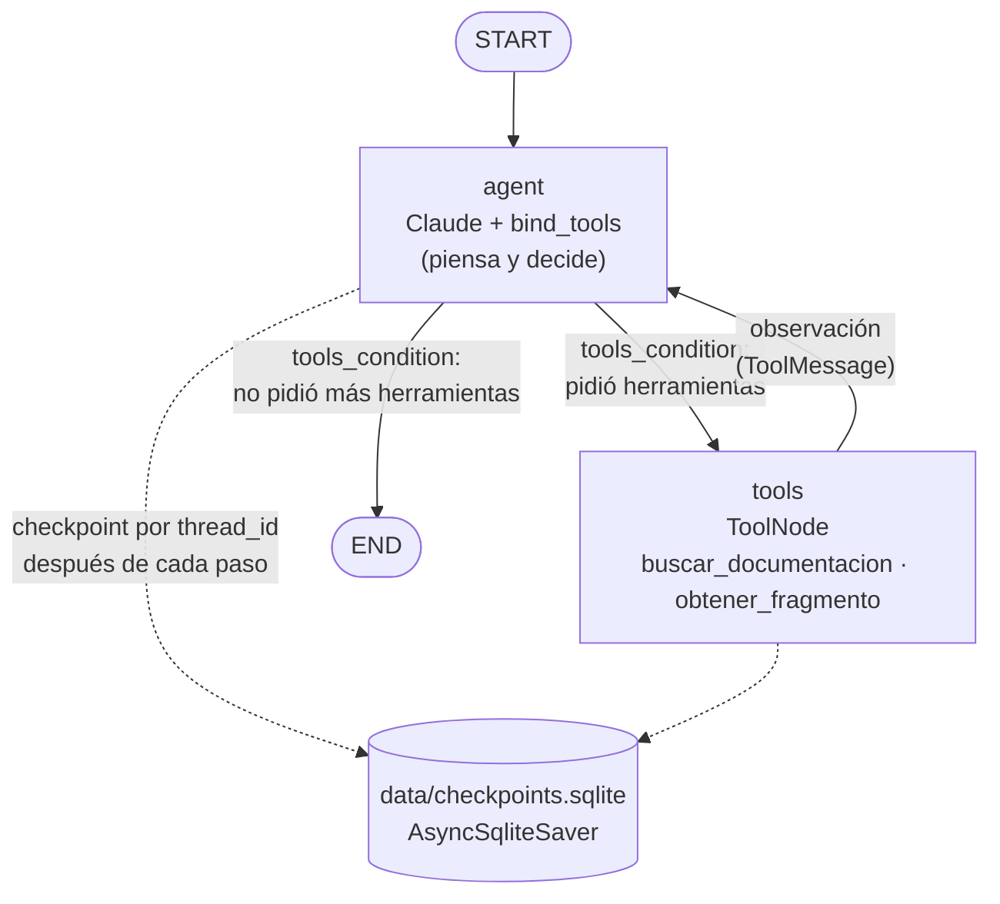

# Pre-entrega 5 — Agente de razonamiento cíclico con memoria persistente

**Curso:** AI Engineering (Coderhouse) · **Stack:** Python 3.12 · LangGraph · Claude (`ChatAnthropic`) · Pinecone · SqliteSaver

Un **asistente técnico** que responde preguntas sobre la documentación oficial de
[httpx](https://www.python-httpx.org/) (la librería HTTP de Python). Esa documentación quedó indexada en
Pinecone en la [Pre-entrega 4](https://github.com/anukvilarasau/pre-entrega-4-httpx) (índice `pre-entrega-4`,
namespace `httpx-docs`, 61 fragmentos), y este agente la reutiliza.

El agente sigue el patrón **ReAct** (*Reason + Act*): piensa, decide **solo** si necesita una herramienta,
la llama, lee el resultado y vuelve a pensar. Repite el ciclo hasta que ya no necesita más herramientas
y responde. Recuerda cada conversación por su `thread_id`, aunque se cierre y se vuelva a abrir el
programa, porque guarda el estado en SQLite.

---

## Índice

1. [Arquitectura del grafo](#1-arquitectura-del-grafo)
2. [Estructura del repositorio](#2-estructura-del-repositorio)
3. [Instalación](#3-instalación)
4. [Cómo se usa](#4-cómo-se-usa)
5. [Herramientas](#5-herramientas)
6. [Escenarios de prueba (trazas reales)](#6-escenarios-de-prueba-trazas-reales)
7. [Cumplimiento de la consigna y la rúbrica](#7-cumplimiento-de-la-consigna-y-la-rúbrica)
8. [Decisiones técnicas y límites](#8-decisiones-técnicas-y-límites)

---

## 1. Arquitectura del grafo



| Pieza | Archivo | Qué hace |
|---|---|---|
| **Estado** | `src/state.py` | `AgentState(TypedDict)` con `messages: Annotated[list[BaseMessage], add_messages]`. Solo datos: el reductor `add_messages` **agrega** cada mensaje nuevo al historial. |
| **Nodo `agent`** | `src/graph.py` | Claude con `.bind_tools(HERRAMIENTAS)`. Recibe el prompt de sistema y el historial (limpio y recortado) y responde o pide herramientas. |
| **Nodo `tools`** | `src/graph.py` | `ToolNode(HERRAMIENTAS)`: ejecuta las herramientas pedidas y devuelve un `ToolMessage` por cada una. |
| **Aristas** | `src/graph.py` | `START → agent`, `add_conditional_edges("agent", tools_condition)`, `tools → agent`. El grafo termina **solo** cuando el LLM no pide más herramientas. |
| **Persistencia** | `src/persistence.py` | `AsyncSqliteSaver` (paquete `langgraph-checkpoint-sqlite`) en `data/checkpoints.sqlite`. Cada invocación usa `config={"configurable": {"thread_id": ...}, "recursion_limit": 10}`. |
| **Trazas** | `src/tracing.py` + `src/runner.py` | Cada corrida se recorre con `astream(stream_mode="updates")` y se guarda como `.json` y `.log` en `traces/`. |

**Historial limpio ("estado sucio").** Antes de llamar al modelo, `preparar_historial()` hace dos cosas:

1. Repara los pedidos de herramienta que quedaron sin respuesta, por ejemplo después de un corte por `recursion_limit`.
2. Si el historial supera ~6000 tokens, lo recorta con `trim_messages`: se queda con lo más reciente y siempre empieza en un mensaje del usuario, así nunca queda un resultado de herramienta suelto.

Lo que se guarda en SQLite queda completo. Solo se achica lo que ve el modelo. Lo probé con un
historial artificial de 163 mensajes: se recortó a 56 y el pedido huérfano quedó reparado.

---

## 2. Estructura del repositorio

```
pre-entrega-5/
├── main.py              # chat por consola: --thread-id, -m "mensaje", --recursion-limit
├── demo.py              # corre los 6 escenarios y genera las trazas
├── src/
│   ├── config.py        # .env, modelo, rutas, límites, validación de claves
│   ├── state.py         # AgentState (TypedDict + add_messages)
│   ├── tools.py         # @tool + args_schema Pydantic: buscar_documentacion, obtener_fragmento
│   ├── graph.py         # StateGraph: agent (LLM) ⇄ tools (ToolNode) + recorte del historial
│   ├── persistence.py   # AsyncSqliteSaver → data/checkpoints.sqlite
│   ├── tracing.py       # traza ReAct → traces/*.json y traces/*.log
│   └── runner.py        # ejecuta un turno (astream + traza + manejo de errores y del corte)
├── traces/              # trazas REALES de la última corrida de demo.py + resumen_demo.json
├── data/                # acá se crea checkpoints.sqlite (no se sube: está en .gitignore)
├── requirements.txt     # versiones fijadas
├── .env.example         # plantilla de configuración (sin claves)
└── .gitignore           # .env, .venv, data/*.sqlite
```

---

## 3. Instalación

Requisitos: **Python 3.12**, una API key de Anthropic y una de Pinecone con el índice de la Pre-entrega 4.

```bash
git clone https://github.com/anukvilarasau/pre-entrega-5.git
cd pre-entrega-5

python3.12 -m venv .venv
source .venv/bin/activate          # en Windows: .venv\Scripts\activate
pip install -r requirements.txt

cp .env.example .env               # y completá las claves
```

`.env` (nunca se sube; está en `.gitignore`):

```ini
ANTHROPIC_API_KEY=sk-ant-...
ANTHROPIC_MODEL=claude-haiku-5-5
PINECONE_API_KEY=pcsk_...
INDEX_NAME=pre-entrega-4
PINECONE_NAMESPACE=httpx-docs
```

> La primera vez se descarga el modelo de embeddings `all-MiniLM-L6-v2` (~90 MB), el mismo que se usó
> para indexar en la Pre-entrega 4.

---

## 4. Cómo se usa

```bash
# Chat interactivo (escribí "salir" para terminar)
python main.py --thread-id mi-sesion

# Un solo mensaje y termina
python main.py --thread-id mi-sesion -m "¿Cómo pongo un timeout en httpx?"

# Los 6 escenarios de la consigna (genera traces/)
python demo.py
```

Con el **mismo `--thread-id`** el agente recuerda la conversación, aunque cierres el programa. Con otro
`--thread-id` la conversación empieza de cero.

**Errores controlados.** Todos fueron probados con valores inválidos:

| Situación | Qué pasa |
|---|---|
| Falta una clave en `.env` | `❌ ERROR: Faltan variables en el .env: ANTHROPIC_API_KEY. Copiá .env.example como .env y completalas.` (sale con código 1, sin traceback) |
| `ANTHROPIC_API_KEY` inválida | `❌ ERROR: La ANTHROPIC_API_KEY del .env es inválida (la API respondió 401).` En modo interactivo el chat sigue abierto. |
| Pinecone no responde o la clave es inválida | La herramienta devuelve `ERROR al buscar en la documentación: ...` **como texto al LLM**. El agente reintentó una vez y le avisó al usuario que el servicio no respondía. El programa no se rompe. |
| Modelo inexistente, error 429 o sin internet | Mensaje claro para cada caso (`runner.explicar_error`). |

---

## 5. Herramientas

Las dos herramientas están en `src/tools.py`. Usan `@tool` con un `args_schema` de Pydantic
(`Field(description=...)` y límites con `ge`/`le`, `min_length`/`max_length`) y tienen docstrings que dicen
**qué hacen, cuándo usarlas y qué devuelven**. Las dos son `async`: las llamadas bloqueantes a Pinecone y
al modelo de embeddings corren en un hilo aparte con `asyncio.to_thread`. Ninguna lanza excepciones al
grafo, porque todo error vuelve como texto al LLM.

| Herramienta | Argumentos | Devuelve |
|---|---|---|
| `buscar_documentacion(query, limit)` | `query`: 3–200 caracteres, en inglés. `limit`: entero entre 1 y 8 (por defecto 3). | Los fragmentos con similitud ≥ **0.45**, cada uno con su ID, similitud, fuente y un extracto. Si ninguno llega al umbral devuelve **`INFORMACIÓN INCOMPLETA: ...`** e indica reformular. Si falla Pinecone devuelve **`ERROR ...`**. |
| `obtener_fragmento(chunk_id)` | `chunk_id` con formato `<doc>-p<página>-c<n>`, por ejemplo `async-p1-c0`. | **Determinística:** el texto completo del fragmento. Si el formato es inválido o el ID no existe devuelve **`ERROR: ...`** y, si puede, **sugiere los IDs válidos** de ese documento. |

El umbral 0.45 se calibró con consultas reales:

- Temas que sí están en la documentación dan 0.47–0.73 (timeouts, proxies, HTTP/2, cookies).
- Temas que no están dan menos: WebSockets 0.40–0.43 y ORM 0.08.

---

## 6. Escenarios de prueba (trazas reales)

Todo lo que sigue sale de **una sola corrida real** de `python demo.py`, hecha el 29/10/2026 con
`claude-haiku-5-5` y el índice de Pinecone de la Pre-entrega 4. Cada escenario tiene su `.json` y su `.log`
en [`traces/`](traces/), y el resumen está en [`traces/resumen_demo.json`](traces/resumen_demo.json).

Cada `.json` guarda:

- `thread_id`, modelo, `recursion_limit`, `inicio` y `fin` con milisegundos, duración y estado;
- `pasos[]`: para cada paso, tipo (`accion`, `observacion`, `respuesta_final` o `corte_recursion_limit`), timestamp, pensamiento, herramienta, argumentos, observación y tokens;
- la respuesta final, las herramientas ejecutadas y los tokens totales.

| # | Escenario | Herramientas ejecutadas | Estado | Traza |
|---|---|---|---|---|
| 1 | Necesita herramienta | `buscar_documentacion`, `obtener_fragmento` | completo | [`.log`](traces/1_usa_herramienta_20261029-200719.log) · [`.json`](traces/1_usa_herramienta_20261029-200719.json) |
| 2 | No necesita herramienta | — | completo | [`.log`](traces/2_sin_herramienta_20261029-200735.log) · [`.json`](traces/2_sin_herramienta_20261029-200735.json) |
| 3 | Multi-paso (2 herramientas) | `buscar_documentacion` → `obtener_fragmento` | completo | [`.log`](traces/3_multi_paso_20261029-200739.log) · [`.json`](traces/3_multi_paso_20261029-200739.json) |
| 4a | Ciclo de retorno: ID inválido | `obtener_fragmento` ✗ → `obtener_fragmento` ✓ | completo | [`.log`](traces/4a_reintento_id_invalido_20261029-200744.log) · [`.json`](traces/4a_reintento_id_invalido_20261029-200744.json) |
| 4b | Ciclo de retorno: información incompleta | `buscar_documentacion` ✗ → `buscar_documentacion` ✗ → pide aclaración | completo | [`.log`](traces/4b_info_incompleta_20261029-200752.log) · [`.json`](traces/4b_info_incompleta_20261029-200752.json) |
| 5a | Memoria en la misma sesión | `buscar_documentacion` (×1 y ×3) | completo | [preg. 1](traces/5a_memoria_pregunta_1_20261029-200758.log) · [preg. 2](traces/5a_memoria_pregunta_2_20261029-200802.log) |
| 5b | Memoria tras reiniciar (mismo `thread_id`) | — (lo recuerda de SQLite) | completo | [`.log`](traces/5b_memoria_tras_reiniciar_mismo_thread_20261029-200818.log) |
| 5c | Otro `thread_id` | — (no recuerda nada) | completo | [`.log`](traces/5c_memoria_otro_thread_20261029-200821.log) |
| 6 | `recursion_limit=3` | 4 búsquedas y corte controlado | cortado_por_recursion_limit | [`.log`](traces/6_recursion_limit_20261029-200810.log) · [`.json`](traces/6_recursion_limit_20261029-200810.json) |

### Escenario 1: pregunta que necesita la herramienta

El agente decide solo que tiene que buscar. Como el primer resultado no era el mejor, también lee el
fragmento completo de `async`.

```text
USUARIO: ¿Cómo hago requests asíncronas con httpx?

[20:07:20.761] ACCIÓN: buscar_documentacion({"query": "AsyncClient usage async requests", "limit": 3})
           tokens: in=2097 out=84
[20:07:30.904] OBSERVACIÓN (buscar_documentacion): 3 fragmento(s) relevante(s) para 'AsyncClient usage async requests':  [ID: http2-p1-c1] similitud=0.54 ...
[20:07:32.265] ACCIÓN: obtener_fragmento({"chunk_id": "async-p1-c0"})
[20:07:32.488] OBSERVACIÓN (obtener_fragmento): [ID: async-p1-c0] fuente=data/async_http2/async.md | categoría=async_http2 # Async Support ...
[20:07:35.440] RESPUESTA FINAL (sin más herramientas)

RESPUESTA: Para hacer requests asíncronas en httpx usás `httpx.AsyncClient` junto con `async`/`await` [async-p1-c0]. ...
ESTADO: completo | DURACIÓN: 16.02 s | HERRAMIENTAS EJECUTADAS: buscar_documentacion, obtener_fragmento
```

> La primera búsqueda tardó ~10 s porque en ese momento se conecta Pinecone y se carga el modelo de
> embeddings. Las siguientes tardan ~0.25 s.

### Escenario 2: pregunta que NO necesita herramienta (autonomía)

```text
USUARIO: ¡Hola! ¿Quién sos y en qué me podés ayudar?

[20:07:39.313] RESPUESTA FINAL (sin más herramientas)
           tokens: in=2103 out=240

RESPUESTA: ¡Hola! Soy un asistente técnico especializado en **httpx**, la librería HTTP para Python. ...
ESTADO: completo | DURACIÓN: 3.87 s | HERRAMIENTAS EJECUTADAS: ninguna
```

### Escenario 3: multi-paso (dos herramientas encadenadas)

La segunda llamada **depende** de la primera: el ID `http2-p1-c0` sale del resultado de la búsqueda.

```text
USUARIO: Buscá cómo se habilita HTTP/2 en httpx y después mostrame el texto completo del fragmento más relevante.

[20:07:40.625] PENSAMIENTO: Voy a buscar en la documentación cómo se habilita HTTP/2 en httpx.
[20:07:40.625] ACCIÓN: buscar_documentacion({"query": "enable HTTP/2 support in httpx client", "limit": 3})
[20:07:40.879] OBSERVACIÓN (buscar_documentacion): 3 fragmento(s) relevante(s) ... [ID: http2-p1-c0] similitud=0.64 ...
[20:07:42.387] PENSAMIENTO: El fragmento más relevante es `http2-p1-c0`, pero el extracto quedó cortado. Lo leo completo.
[20:07:42.387] ACCIÓN: obtener_fragmento({"chunk_id": "http2-p1-c0"})
[20:07:42.611] OBSERVACIÓN (obtener_fragmento): [ID: http2-p1-c0] fuente=data/async_http2/http2.md | categoría=async_http2 # HTTP/2 ...
[20:07:44.410] RESPUESTA FINAL (sin más herramientas)

RESPUESTA: Para habilitar HTTP/2 en httpx hay que hacer dos cosas: instalar la dependencia opcional y pasar `http2=True` al cliente. ...
```

### Escenario 4a: ciclo de retorno con error → reintento con otros argumentos

```text
USUARIO: Mostrame el fragmento async-p7-c0 de la documentación.

[20:07:46.080] ACCIÓN: obtener_fragmento({"chunk_id": "async-p7-c0"})
[20:07:46.502] OBSERVACIÓN (obtener_fragmento): ERROR: el fragmento 'async-p7-c0' no existe. IDs válidos del documento 'async': async-p1-c0, async-p1-c1, async-p1-c2.
[20:07:48.673] PENSAMIENTO: El ID `async-p7-c0` no existe. El documento `async` tiene `async-p1-c0`, `async-p1-c1` y `async-p1-c2`, así que pruebo con el primero.
[20:07:48.673] ACCIÓN: obtener_fragmento({"chunk_id": "async-p1-c0"})
[20:07:48.894] OBSERVACIÓN (obtener_fragmento): [ID: async-p1-c0] fuente=data/async_http2/async.md ...
[20:07:52.619] RESPUESTA FINAL (sin más herramientas)

RESPUESTA: No existe `async-p7-c0` en la base: el documento `async` solo tiene tres fragmentos (...). Como alternativa te muestro `async-p1-c0` ...
```

### Escenario 4b: información incompleta → segundo intento → pide aclaración

```text
USUARIO: ¿Cómo abro una conexión WebSocket con httpx?

[20:07:54.190] PENSAMIENTO: Voy a buscar en la documentación si httpx tiene soporte para WebSocket.
[20:07:54.190] ACCIÓN: buscar_documentacion({"query": "WebSocket support connection", "limit": 3})
[20:07:54.433] OBSERVACIÓN (buscar_documentacion): INFORMACIÓN INCOMPLETA: ningún fragmento es relevante para 'WebSocket support connection' (mejor similitud 0.40, umbral 0.45). ...
[20:07:55.468] PENSAMIENTO: Voy a reintentar con otros términos técnicos.
[20:07:55.468] ACCIÓN: buscar_documentacion({"query": "upgrade connection websocket protocol", "limit": 3})
[20:07:55.662] OBSERVACIÓN (buscar_documentacion): INFORMACIÓN INCOMPLETA: ... (mejor similitud 0.41, umbral 0.45). ...
[20:07:58.548] RESPUESTA FINAL (sin más herramientas)

RESPUESTA: No encontré nada sobre WebSocket en la documentación de httpx que tengo indexada. Hice dos búsquedas con distintos
términos en inglés y ninguna superó el umbral de relevancia [...]. Si querés, podés hacer alguna de estas cosas:
- Decirme si buscás una conexión WebSocket con httpx en sí, o si te sirve una alternativa [...]
```

### Escenario 5: memoria (misma sesión, después de reiniciar y con otro `thread_id`)

**5a, misma sesión** (`thread_id=memoria-20261029-200719`). El segundo mensaje no dice de qué habla y el
agente lo entiende por el primero:

```text
USUARIO: ¿Qué es un AsyncClient en httpx?
RESPUESTA: Un `AsyncClient` es la versión asíncrona del cliente de httpx. ...

USUARIO: ¿Y cómo se usa?
[20:08:04.405] PENSAMIENTO: Voy a buscar ejemplos de uso más completos, como requests concurrentes y cierre manual del cliente.
[20:08:04.405] ACCIÓN: buscar_documentacion({"query": "AsyncClient concurrent requests asyncio gather example", "limit": 3})
...
RESPUESTA: El uso básico de `AsyncClient` es siempre dentro de una corrutina `async def`, creando el cliente con `async with` ...
```

**5b, después de cerrar el programa.** `demo.py` cierra la base SQLite y lanza un **proceso nuevo** de
`python main.py --thread-id memoria-20261029-200719 -m "..."`. El proceso nuevo no tiene nada en memoria
RAM: todo lo que sabe lo lee de `data/checkpoints.sqlite`.

```text
USUARIO: Recordame: ¿de qué clase de httpx estábamos hablando y qué te pregunté recién?
[20:08:20.318] RESPUESTA FINAL (sin más herramientas)
           tokens: in=5843 out=199        ← 5843 tokens de entrada: el historial previo se cargó de SQLite

RESPUESTA: Estábamos hablando de `httpx.AsyncClient`, la versión asíncrona del cliente de httpx.
Tu última pregunta fue "¿Y cómo se usa?". Te expliqué el uso básico con `async with` y `await` ...
```

**5c, otro `thread_id`** (`otro-20261029-200719`), en otro proceso nuevo y con la misma pregunta:

```text
USUARIO: Recordame: ¿de qué clase de httpx estábamos hablando y qué te pregunté recién?
           tokens: in=2112 out=186        ← solo el prompt de sistema: no hay historial

RESPUESTA: No tengo nada registrado de una conversación anterior: este es el primer mensaje que recibo en este chat. ...
```

Checkpoints guardados en SQLite después de la corrida (`select thread_id, count(*) from checkpoints group by thread_id`):

```text
esc1-20261029-200719|7     esc4a-20261029-200719|7     memoria-20261029-200719|15
esc2-20261029-200719|3     esc4b-20261029-200719|7     otro-20261029-200719|3
esc3-20261029-200719|7     esc6-20261029-200719|6
```

### Escenario 6: `recursion_limit` (corte controlado)

Con un techo de **3 pasos** y una pregunta que pide comparar cuatro temas, el agente lanza 4 búsquedas
en paralelo (paso 1, `agent`) y las ejecuta (paso 2, `tools`). En el paso 3 vuelve a pensar y pide 3
herramientas más, pero ya no hay pasos disponibles. LangGraph lanza `GraphRecursionError`; `runner.py` la
captura, registra el corte, responde con un aviso y deja el hilo limpio: los pedidos pendientes quedan
marcados como "cancelados", así ese `thread_id` se puede seguir usando.

```text
USUARIO: Comparame en detalle cómo se configuran en httpx los proxies, la autenticación, los timeouts y HTTP/2.

[20:08:13.637] PENSAMIENTO: Voy a buscar en paralelo la documentación de proxies, autenticación, timeouts y HTTP/2, porque son consultas independientes.
[20:08:13.637] ACCIÓN: buscar_documentacion({"query": "configure proxies in httpx client proxy argument", "limit": 3})
[20:08:13.637] ACCIÓN: buscar_documentacion({"query": "authentication auth parameter httpx basic digest custom auth", "limit": 3})
[20:08:13.637] ACCIÓN: buscar_documentacion({"query": "set timeouts connect read write pool httpx Timeout", "limit": 3})
[20:08:13.637] ACCIÓN: buscar_documentacion({"query": "enable HTTP/2 http2=True httpx requires h2 package", "limit": 3})
[20:08:14.443] OBSERVACIÓN (buscar_documentacion): 3 fragmento(s) relevante(s) ... (×4)
[20:08:16.869] PENSAMIENTO: Ya tengo el panorama general. Ahora busco el detalle de HTTP/2 (cómo activarlo en el cliente) y leo completos los fragmentos de proxies y timeouts.
[20:08:16.869] ACCIÓN: buscar_documentacion({"query": "http2=True client instance response http_version HTTP/2 example", "limit": 3})
[20:08:16.869] ACCIÓN: obtener_fragmento({"chunk_id": "proxies-p1-c0"})
[20:08:16.869] ACCIÓN: obtener_fragmento({"chunk_id": "timeouts-p1-c1"})
[20:08:16.874] CORTE POR recursion_limit: las acciones pendientes NO se ejecutaron

RESPUESTA: Me detuve de forma controlada: alcancé el límite de 3 pasos (recursion_limit) antes de terminar. Probá con una pregunta más concreta.
ESTADO: cortado_por_recursion_limit | DURACIÓN: 6.66 s | HERRAMIENTAS EJECUTADAS: buscar_documentacion ×4
```

En uso normal el techo es **10** (`config.RECURSION_LIMIT`). Se puede cambiar con `python main.py --recursion-limit N`.

---

## 7. Cumplimiento de la consigna y la rúbrica

### Entregables

| Pedido | Dónde |
|---|---|
| Repositorio público de GitHub | este repo |
| `StateGraph` de LangGraph | `src/graph.py` → `construir_grafo()` |
| Al menos una herramienta propia | `src/tools.py`: `buscar_documentacion` y `obtener_fragmento` |
| Persistencia con SqliteSaver | `src/persistence.py`: `AsyncSqliteSaver` → `data/checkpoints.sqlite` |
| Traza ReAct guardada como log/.json en el repo | `traces/*.json` + `traces/*.log` + `traces/resumen_demo.json` |
| README.md | este archivo |

### Criterios de aceptación

| Criterio | Cómo se cumple | Evidencia |
|---|---|---|
| **1. Autonomía** | No hay ningún `if/else` que elija la ruta según la pregunta. El LLM recibe las herramientas con `bind_tools` y decide; `tools_condition` solo mira si el LLM pidió herramientas. | Escenario 2 (sin herramientas) frente a escenarios 1 y 3 (con herramientas), con el mismo grafo. |
| **2. Ciclo de retorno** | Las herramientas devuelven `ERROR`/`INFORMACIÓN INCOMPLETA` como texto y la arista `tools → agent` vuelve a pasar por el LLM, que reintenta con otros argumentos o pide aclaración. | 4a: ID inválido → reintento con un ID sugerido. 4b: dos búsquedas vacías → pide aclaración. 5a: una búsqueda vacía → reformula. |
| **3. Resiliencia de estado** | `AsyncSqliteSaver` guarda un checkpoint por paso y por `thread_id`. | 5a (misma sesión), 5b (**proceso nuevo**, recuerda) y 5c (otro `thread_id`, no recuerda). |
| **4. Código limpio** | Python **3.12.16**, type hints en todas las funciones (verificado con `mypy --disallow-untyped-defs`: *Success: no issues found in 10 source files*) y **asyncio** de punta a punta: nodos `async`, herramientas `async`, `astream`, `AsyncSqliteSaver` y `asyncio.to_thread` para lo bloqueante. | `src/` |

### Rúbrica

| Ítem | Peso | Cómo se cubre |
|---|---|---|
| Arquitectura del grafo y gestión de estado | 30 % | `TypedDict` + `add_messages`, con el estado separado de los clientes. Nodos `agent`/`tools` con `tools_condition`. Recorte del historial (`trim_messages`), reparación de pedidos huérfanos y limpieza del hilo tras un corte. `recursion_limit` en todas las invocaciones. |
| Integración de herramientas y razonamiento multi-paso | 35 % | Dos herramientas con `args_schema` Pydantic (`Field`, `ge/le`, longitudes), docstrings con "qué, cuándo y qué devuelve", y `try/except` que devuelve los errores como texto. Encadenamiento búsqueda → ID → fragmento, reintentos y llamadas en paralelo. |
| Persistencia con SqliteSaver | 20 % | `AsyncSqliteSaver` del paquete `langgraph-checkpoint-sqlite`, memoria por `thread_id` probada entre procesos distintos y aislamiento entre hilos. |
| Calidad del repo y entorno profesional | 15 % | Estructura modular, `requirements.txt` con versiones fijadas, `.env.example`, `.gitignore` (sin `.env` ni `.sqlite`), validación de claves con mensajes claros, comentarios en español y logs con milisegundos. |

---

## 8. Decisiones técnicas y límites

- **Temperatura 0.** La consigna la pide, pero desde octubre de 2026 la API de Claude **rechaza** el parámetro
  `temperature` en los modelos actuales (`claude-haiku-5-5` incluido), igual que ya pasó en las Pre-entregas 3
  y 4. En su lugar se usa `effort="low"` para tener respuestas directas y estables. Por eso, si se vuelve a
  correr `demo.py`, el texto de las respuestas puede variar un poco aunque el comportamiento sea el mismo.
- **Modelo:** `claude-haiku-5-5` (barato), configurable con `ANTHROPIC_MODEL` en el `.env`.
- **Búsqueda vectorial pura.** La Pre-entrega 4 tenía además un modo híbrido con BM25. Acá alcanza con la
  búsqueda vectorial y un umbral de relevancia, que es lo que permite detectar la "información incompleta".
- **Consultas en inglés.** El modelo de embeddings y los documentos están en inglés: una consulta en
  castellano da similitudes bajas (por ejemplo, "como configuro un timeout" da 0.36). Por eso el
  `args_schema` y el prompt le piden al LLM que busque en inglés; el agente responde en castellano.
- **Llamadas en paralelo.** Claude puede pedir varias herramientas en un mismo paso, y `ToolNode` las ejecuta
  juntas, como se ve en el escenario 6. Cada llamada aparece por separado en la traza.
- **Pensamiento en la traza.** El "pensamiento" es el texto que Claude escribe antes de pedir una
  herramienta; el prompt se lo pide en una línea. A veces el modelo va directo a la acción y ese paso queda
  sin pensamiento, como en la primera acción del escenario 1.
- **Nombres de las trazas.** `<escenario>_<AAAAMMDD-HHMMSS>.json/.log`. En el modo interactivo se usa el
  `thread_id` como nombre.
